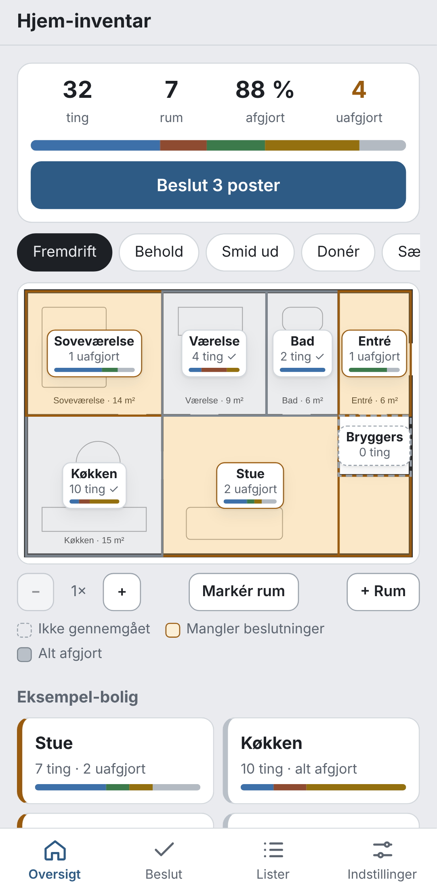
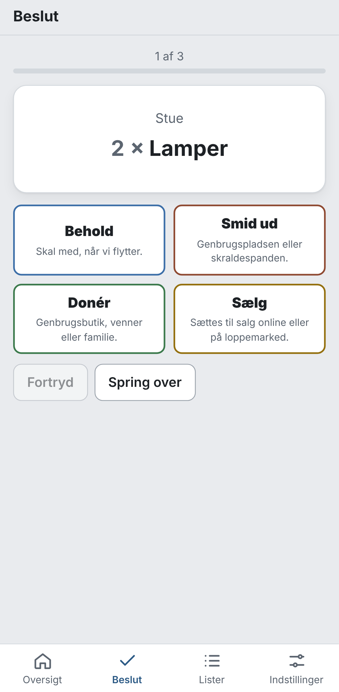

# Hjem-inventar

Gå rundt i boligen med telefonen, sig hvad der står i hvert rum, og beslut hvad der skal **med**, **smides ud**,
**doneres** eller **sælges**. Oversigten er boligens egen plantegning: hvert rum viser selv, hvor langt det er.

<p>
  
  
</p>

*Skærmbillederne viser den fiktive eksempel-bolig, der følger med appen.*

## Sådan bruges den

1. **Læg plantegningen ind.** Har du den som PDF, så tag et skærmbillede af den og vælg billedet. Én tegning pr. etage.
2. **Markér rummene.** Træk en firkant over hvert rum med fingeren. Et L-formet rum kan få to firkanter.
   *Har du ikke plantegningen endnu?* Brug **Hurtigstart**: skriv antal værelser og badeværelser fra
   BBR-meddelelsen, så opretter appen rummene. Når tegningen kommer, markerer du dem på den.
3. **Indtal et rum.** Tryk på rummet og derefter på »Indtal ting«, og sig hvad du ser:
   > »en sofa, to lamper og en kasse med gamle kabler. Printeren skal smides ud.«

   Appen laver det om til en liste, som du retter, før den gemmes. Sig »skal med«, »skal smides ud«, »doneres«
   eller »sælges« efter en ting for at beslutte med det samme.
4. **Beslut.** Én uafgjort ting ad gangen med fire store knapper: Behold, Smid ud, Donér og Sælg.
5. **Brug listerne.** »Smid ud« til genbrugspladsen, »Sælg« til annoncerne. De kan kopieres eller printes.

På tegningen er et rum **stiplet**, hvis det ikke er gennemgået, **gult**, hvis der mangler beslutninger, og **gråt**,
når alt er afgjort. Med filtrene (Smid ud, Donér …) ser du, hvor i huset der er mest af hver slags.

Tip: en post behøver ikke være én genstand. »Kasse med køkkengrej« er fint – det handler om beslutninger, ikke
om at tælle gafler.

## Dine data

- Alt ligger **kun på telefonen** (i browserens IndexedDB). Der er ingen server og ingen login.
- **Installér appen på hjemmeskærmen** (iPhone: Del → »Føj til hjemmeskærm«, Android: ⋮ → »Installér app«).
  Så virker den offline, og browseren rydder ikke dataene.
- **Tag backup** under Indstillinger af og til. Backuppen er én fil med alt, også plantegningerne, og kan gendannes
  på en ny telefon. Appen minder dig om det efter 14 dage.
- **Eksportér til Excel** (CSV) for at få hele inventaret som regneark.

## Teknik

- HTML, CSS og vanilla JavaScript (ES-moduler). Ingen frameworks, ingen build-step og ingen afhængigheder.
- PWA med service worker, så appen virker offline.
- Talegenkendelse via browserens Web Speech API (`da-DK`). Uden den kan tastaturets mikrofon bruges.
- En lille dansk parser (`js/parse/parse-da.js`) gør tale til poster: den deler på komma, »og« og pauser, læser antal
  (»to lamper«) og beslutninger (»skal smides ud«).
- Lagdelt: `js/model/` og `js/parse/` er rene funktioner, der testes i Node. `js/ui/` tegner kun.
  Farver findes kun i `css/app.css` (lyst og mørkt tema).

```
js/
├── model/   beslutninger, inventar, statistik, plantegningsgeometri, eksempel-bolig
├── parse/   dansk tale → poster
├── data/    IndexedDB, CSV/JSON-eksport
└── ui/      oversigt, markering af rum, rum, indtaling, beslut, lister, indstillinger
```

### Kør lokalt

```bash
python3 -m http.server 8080
```

Åbn derefter http://localhost:8080.

### Tests

```bash
node --test
```

### Deploy

Statisk mappe på Netlify. `netlify.toml` publicerer roden, og der er ingen build-kommando.

## Plan

Bygges i faser – se [PLAN.md](PLAN.md). Fase 1 (plantegning, indtaling, beslutninger, eksport) er færdig.
Fase 2 er flytningen: flyttekasser med destinationsrum på det nye hjems plantegning, etiketter og søgning.
Fase 3 er Claude: forståelse af rodet tale og fotos af hylder, og forslag til rum ud fra plantegningen.
